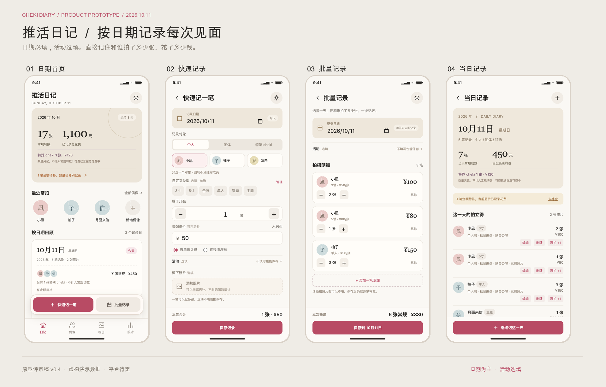
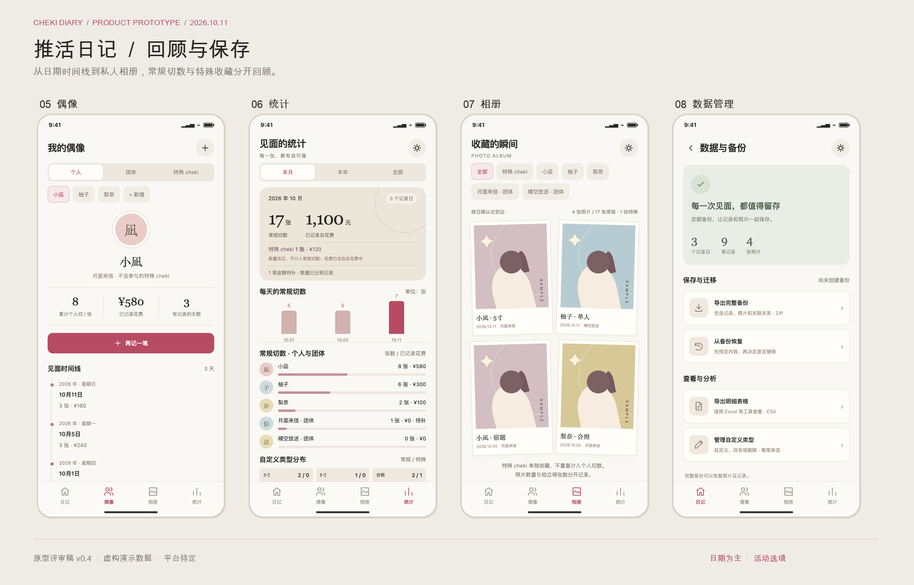

# cheki_record

面向地下偶像粉丝的拍立得记录工具，用于按日期记录和谁拍了多少张、花了多少钱。活动是可选标签，不填也能正常保存和回顾。

当前处于产品原型评审阶段。小程序、App Store 应用或网页版尚未决定。

第一版范围：

- 支持现场速记和批量记录，可连续录入多笔；每笔常规记录只关联一个个人或团体，活动完全选填。
- 常规切数与特殊数量分开；特殊 cheki 可关联多位偶像，不进入全局或个人常规切数。
- 统计实际花费，每笔只计一次；特殊花费单列且包含在总花费内。
- 拍立得类型完全自定义，个人、团体及特殊 cheki 均每笔单选，可自行创建、改名和删除。
- 可选上传照片，按日期、个人、团体或特殊 cheki 浏览相册。
- 支持数据备份、恢复和导出。

## 产品文档与原型

- [PRD v0.4](docs/PRD.md)：功能范围、8 个页面的交互说明、数据规则和验收标准。
- [带原型图的 PRD PDF](output/pdf/cheki-diary-prd.pdf)：14 页，适合阅读和评审。
- [可点击产品原型](docs/prototype/index.html)：快速记录、批量记录、当日详情、偶像与特殊收藏、统计、相册与数据管理。
- [当前需求基线](docs/requirements.md)：需求讨论的基线。






## 预览

克隆仓库后，直接使用浏览器打开 `docs/prototype/index.html`，无需安装依赖。
GitHub 的文件页只展示源码；本地打开或使用静态服务器才能体验交互。

也可从仓库根目录运行：

```sh
python3 -m http.server 4173 --bind 127.0.0.1
```

浏览器访问 `http://127.0.0.1:4173/docs/prototype/index.html`。

原型使用虚构演示数据，修改只保留在当前页面内存中，刷新后重置；照片在本地读取，不上传服务器。
CSV 可以实际导出，完整 ZIP 备份与恢复仅模拟流程。请勿用此原型保存真实收藏。

原型覆盖范围和生成图片、PDF 的方式见 [原型说明](docs/prototype/README.md)。
