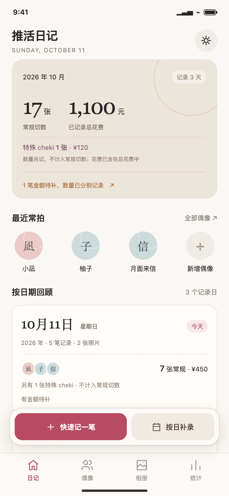
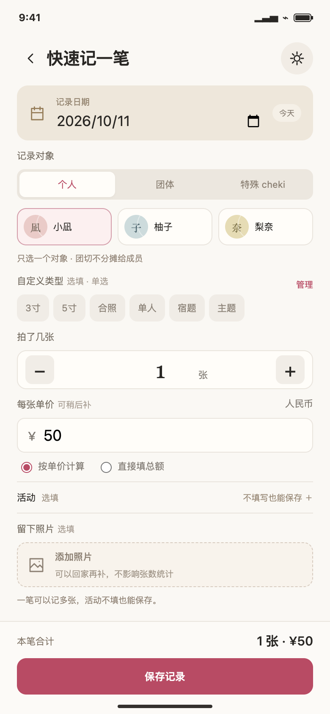
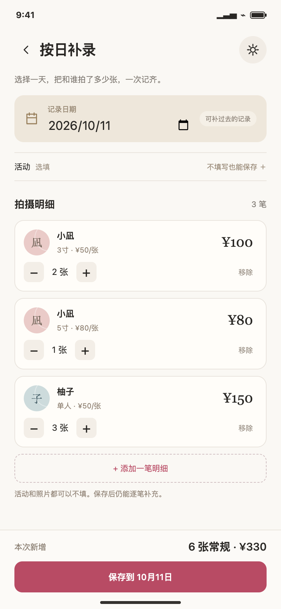
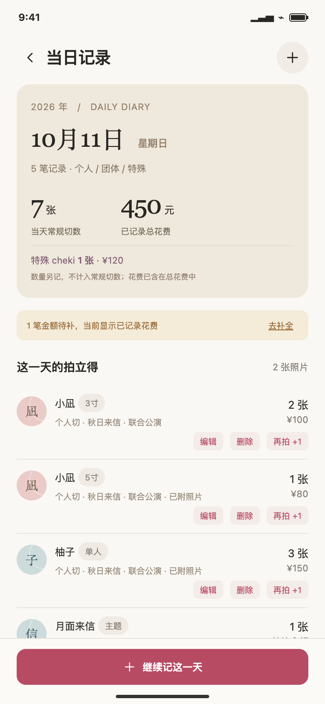
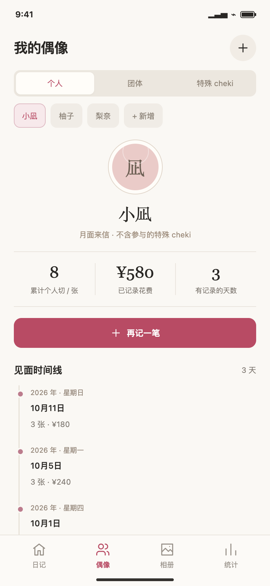
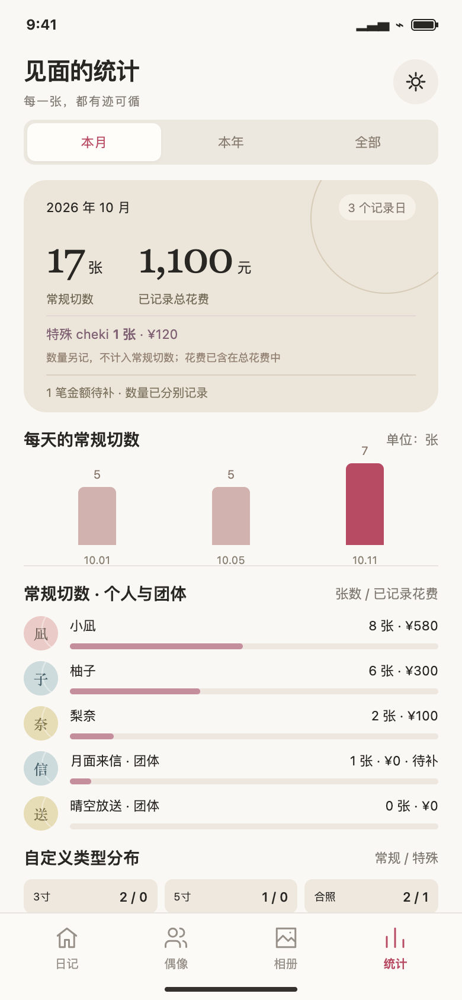
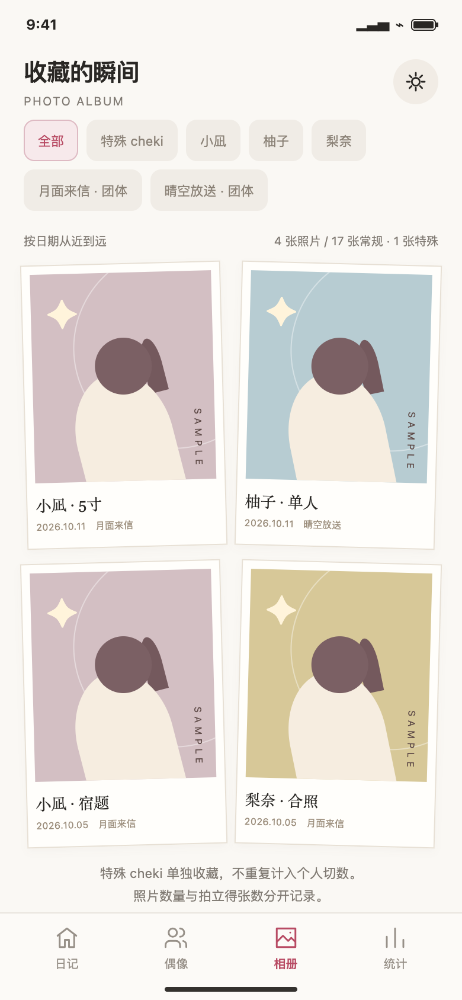
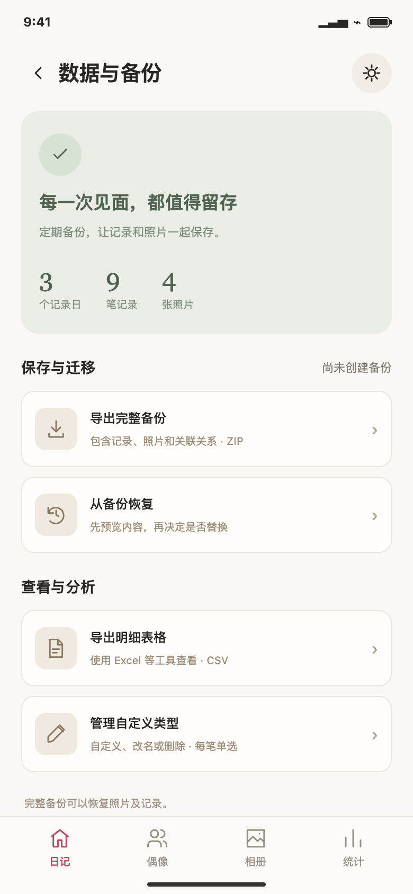
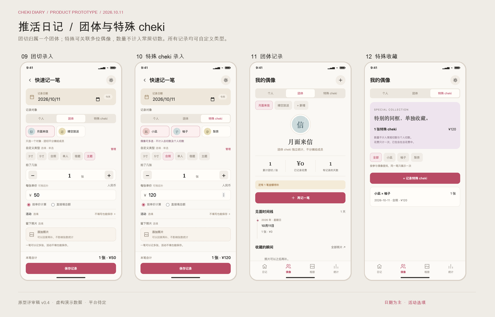

# 推活日记 产品需求文档

版本：v0.4 · 日期：2026 年 10 月 11 日 · 状态：原型评审稿

推活日记帮助地下偶像粉丝按日期记录和谁拍了多少张拍立得、花了多少钱。既支持现场快速记一笔，也支持事后按日补录。**日期是组织主线；活动、照片可选；类型自定义单选；常规记录归属一个个人或团体，特殊 cheki 可关联多人但数量另计。**

本稿依据[已确认需求](requirements.md)整理，不预先决定微信小程序、原生 App 或网页形态。

## 交付物与使用方式

- [可点击原型](prototype/index.html)：本地用浏览器打开，桌面侧栏可切换 8 个页面。
- [记录流程原型图](prototype/recording-overview.png)：日期首页、快速记录、按日补录、当日记录。
- [回顾与数据原型图](prototype/review-overview.png)：偶像、统计、相册、数据管理。
- [团体与特殊 cheki 原型图](prototype/special-overview.png)：团切录入、特殊录入、团体记录、特殊收藏。
- [带原型图的 PDF](../output/pdf/cheki-diary-prd.pdf)：14 页产品与交互说明。

原型使用虚构人物、活动及示例插画。修改只保留在当前页面内存，刷新后恢复样例，不能用来保存真实收藏。活动不填写的场景已包含在样例中。

## 目标与范围

现场节奏快，粉丝会连续与不同偶像拍摄，容易忘记对象、数量或花费。产品应允许直接记下今天的拍立得，而不是先整理或创建活动。

| 优先级 | 功能 | 达成标准 |
| --- | --- | --- |
| P0 | 快速记录与按日补录 | 日期、对应分类的关联对象和张数有效即可保存 |
| P0 | 日期列表与当日明细 | 同一天所有记录一起回顾，活动可有可无 |
| P0 | 数量与金额统计 | 常规与特殊数量分列，日期、对象、类型口径一致 |
| P0 | 个人、团体与特殊收藏 | 个人和团体独立统计；特殊可关联多人，不混入常规切数 |
| P1 | 可选活动 | 可以不填、后补、修改或清除，不影响记账主流程 |
| P1 | 可选照片与相册 | 照片关联记录，按日期、对象或特殊收藏回顾 |
| P1 | 类型管理 | 完全由用户定义的单选类型，如 3寸、5寸、合照、单人、宿题、主题 |
| P1 | 备份、恢复、导出 | 完整数据可恢复，无活动记录同样可备份与导出 |

P0 / P1 仅表示开发顺序，全部属于第一版目标范围。第一版以个人使用为主，不加入公开社区、售卖、票务或官方偶像数据库。

可用性目标待真人测试：熟悉用户约 10 秒完成一笔记录，3 位偶像的多笔记录约 1 分钟补完。不填写活动与照片时，不增加额外确认步骤。

## 信息架构与流程

主导航为「日记 / 偶像 / 相册 / 统计」，数据管理从右上角进入。首页按日期列出记录，不以活动名称作为卡片标题。

| 流程 | 页面路径 | 成功状态 |
| --- | --- | --- |
| 现场记录 | 日期首页 → 快速记一笔 → 当日记录 | 直接保存，默认今天，活动允许为空 |
| 事后补录 | 按日补录 → 选日期 → 添加多笔明细 → 保存 | 追加到对应日期，保留当天已有记录 |
| 查账修正 | 当日记录 → 编辑日期 / 金额 / 类型 → 保存 | 相关日期与统计同步更新 |
| 对象回顾 | 偶像页面（个人 / 团体） → 日期时间线 → 当日记录 | 仅统计归属该对象的常规记录 |
| 特殊收藏 | 偶像 → 特殊 cheki → 按参与偶像查找 | 可关联多人，仅检索，不增加个人切数 |
| 照片回顾 | 相册 → 照片详情 → 对应日期 | 无活动照片也可正常浏览 |
| 数据迁移 | 数据管理 → 备份或恢复预览 | 日期、可选活动、照片关联保持一致 |

## 页面原型与交互

### S01 日期首页

- 本月常规切数、已记录总花费、有记录的天数同时显示；特殊数量和花费另列；天数按记录日期去重，不能称作场次。
- 「快速记一笔」与「按日补录」放在底部导航上方的悬浮操作区，滚动日期列表时持续可见。无需创建活动。
- 常拍个人或团体头像直接开启录入并带入对象，日期默认今天。
- 日期卡片以「10月11日 星期日」为标题，显示明细数、照片数、常规切数与总花费，特殊数量单列。
- 日期卡汇总同一天全部记录，无论是否填写活动；活动不作为首页主要层级。
- 金额缺失有待补提示；活动为空不显示警告、不计入待补。
- 列表底部预留悬浮区空间，最后一条记录可完整滚出遮挡；两个入口触控高度至少 44 像素。首次使用仍保留悬浮入口并展示空状态。

### S02 快速记录

- 日期输入置顶，默认今天，可以直接补录过去日期；从当日记录继续添加时带入该日期。
- 记录分类为个人、团体或特殊。个人 / 团体只选一个对象，特殊可多选参与偶像；日期和正整数张数必填，张数默认 1。
- 金额支持按单价计算或直接填实付总额；暂时留空记为待补，明确填 0 表示免费。
- 所有分类共用自定义类型，包括团切和特殊 cheki。每笔单选或留空；3寸、合照、宿题等仅为演示用户创建的名称。
- 点击另一个类型会替换原选择，不叠加；用户也可直接创建「3寸合照」这样的一条类型名称。
- 活动位于可展开的选填区，默认收起且为空。用户可输入或选择名称，也可一直不填。
- 不填活动直接保存为空，不自动创建「未命名活动」，也不要求确认跳过。
- 照片选填，可保存后再补，多张照片不改变录入张数。
- 保存后进入相应日期的记录页，提供撤销；编辑复用表单并更新原记录，不重复新增。
- 修改日期仅移动该笔记录，活动标签保留；补填或清除活动不修改日期、张数及金额。

### S03 按日补录

- 先选日期，连续添加个人、团体或特殊明细。普通明细单对象；特殊明细多参与者，不需要先有活动。
- 活动选填区默认收起。填写时只统一应用于本次新增明细；留空时这些明细的活动字段为空。
- 每笔明细可编辑记录分类、对象、类型、数量、价格，支持增减张数、移除和继续添加。
- 底部显示「本次新增」常规切数、特殊数量与花费，不和当天已有总数混淆。
- 保存时追加独立记录到所选日期，保留同一天原有记录，不创建日期容器或虚构活动。
- 允许同一天混合有活动和无活动的记录；保存后可逐笔补充、修改或清除活动。
- 日期无效或没有明细时不能保存。正式版补充草稿保留和离开未保存页的处理。

### S04 当日记录

- 日期与星期是主要标题，展示记录数、常规切数、特殊数量及已记录总花费。
- 当天全部明细一起展示；活动填过时作为对应明细的辅助文字，不分割主日期视图。
- 未填活动直接省略该标签，没有待补活动、无活动分组或补全活动提醒。
- 每笔显示个人 / 团体对象或特殊参与者，以及类型、数量、金额和照片状态，可编辑、删除或继续追加。
- 固定单价记录点「再拍 +1」同步计算；手动实付总额进入编辑页核对后保存。
- 「继续记这一天」带入当前日期，活动仍默认留空，不自动继承上一笔的活动。
- 删除支持撤销，连同照片关联恢复；记录移到其他日期后，原日期与新日期的合计即时更新。

### S05 偶像

- 「偶像」页面按个人、团体、特殊 cheki 切换。个人与团体显示名称、常规切数、花费及有记录的天数。
- 天数按该对象常规记录的不同日期去重，同一天多笔、多活动只计一天，不能解释为见面场次。
- 时间线以日期为主标题，展示该日数量与花费；无活动记录同样出现。
- 点击时间线进入当日记录，便于核对数字来源；直接记一笔自动带入当前个人或团体。
- 照片按记录日期展示，可进入当前对象的筛选相册。特殊收藏按参与偶像查找，不计入个人切数。
- 个人与团体以固定 ID 关联；团切不分摊给成员。特殊花费只记在特殊分类，不分摊给参与者。

### S06 统计

- 支持本月、本年和全部，正式版补充自选日期范围。
- 时间归属使用每笔记录日期，不读取活动日期，也不依赖活动是否存在。
- 常规切数与已记录总花费展示；特殊数量和花费单列，特殊花费已含在总花费内，缺失金额可见。
- 图表展示每天常规切数，排除特殊；同一天不同活动和无活动一起汇总。
- 个人和团体榜仅统计归属它们的常规记录。类型分布分列常规 / 特殊，包含未填写；两列分别与对应数量对齐。
- 活动只能作为可选额外筛选；不把全部数据的活动场次数当成主要指标。
- 正式版类型统计同时提供金额，当前原型先展示张数分布验证层级。

### S07 相册

- 照片以对应记录日期从近到远排列，并可按个人、团体或特殊 cheki 筛选；正式版增加日期区间筛选。
- 照片卡标明对象或特殊参与者、类型及日期；点开显示对应记录，活动仅在填写后出现。
- 同时区分照片数量与拍立得张数，不要求两者相等。
- 上传、删除或替换照片不影响张数或金额；没有活动也能保存、浏览与备份照片。
- 没有照片时提示可慢慢补，不强制上传；原型图像为虚构示例插画。
- 从照片回到当日记录，不要求先找到所属活动。

### S08 数据管理

- 展示记录日、明细、照片数量，活动不作为必备数据规模指标。
- 完整 ZIP 备份包含记录日期、分类、个人 / 团体对象、特殊参与者、类型、可选活动、照片和版本信息。
- 无活动记录的日期与照片关联必须完整保留，导出和恢复不补造活动。
- CSV 保留分类、归属对象、特殊参与者、类型与计数标记；日期必填，活动和金额可空，免费为 0，不包含照片。
- 恢复前校验文件、预览数量与覆盖范围，再确认、备份当前状态并原子替换；失败保留原数据。
- 同一份备份重复恢复不重复增加记录。第一版整库替换，合并导入后续讨论。
- 当前原型可实际导出 CSV；ZIP 和恢复仅模拟流程，真实备份、校验和持久化待实现。

## 团体与特殊 cheki

| 分类 | 关联方式 | 全局常规切数 | 对象切数 | 自定义类型 |
| --- | --- | --- | --- | --- |
| 个人 | 一位偶像 | 计入 | 仅该偶像 | 单选或留空 |
| 团体 | 一个团体 | 计入 | 仅该团体，不分摊成员 | 单选或留空 |
| 特殊 cheki | 一位或多位参与偶像 | 不计入，特殊数量单列 | 不计入任何偶像或团体 | 单选或留空 |

特殊的多偶像关联只用于检索、展示和回顾，不是多份记账。用户可主动切换一笔的分类；保存后按新分类重新计算，记录 ID、日期、类型、照片及实付金额保持不变，清除旧分类不适用的对象字段。类型名不会自动决定分类。

**金额设计建议（尚非用户明确确认项）：**已记录总花费包含所有分类的实际支出，每笔只计一次；特殊花费单列，属于总花费的组成部分，不分摊到个人或团体账下。例如个人 2 张 100 元、团切 1 张 80 元、特殊 A+B 1 张 120 元，应显示常规 3 张、特殊 1 张、总花费 300 元，其中特殊 120 元；A、B 的个人切数不因特殊记录增加。

## 数据模型与统计规则

| 实体 | 关键字段 | 关系与约束 |
| --- | --- | --- |
| 记录 Record | id、date、kind、targetId、participantIds、typeId、quantity、amount、currency、priceMode、unitPrice、eventId | kind 为 regular / special；常规 targetId 必填且 participantIds 为空，特殊 targetId 为空、participantIds 至少一位且去重 |
| 对象 Target | id、kind、名称、所属团体信息、头像、状态 | kind 为 idol / group；固定身份；团体无需先配置全体成员 |
| 可选活动 Event | id、名称、地点、备注 | 可被零至多笔引用，非必备容器；不决定记录日期 |
| 类型 Type | id、名称、状态 | 所有记录分类共享的单选配置；改名同步，删除仅清除关联 |
| 照片 Photo | id、recordId、文件引用、上传状态 | 直接关联记录，不通过活动关联 |
| 备份 Manifest | schemaVersion、导出时间、实体数量、文件清单 | 保留可空活动字段，不依赖远程临时链接 |

1. 日期视图是按 Record.date 的查询聚合，无需单独创建日期实体或活动实体。
2. 日期保存为用户实际拍摄的日历日，独立于记录创建时间与活动信息，避免时区转换跨日。
3. 常规切数只汇总 kind=regular 的 quantity；特殊数量仅汇总 kind=special。照片数独立，不遗漏空活动记录，也不按参与者展开后累加。
4. 正式金额使用最小货币单位整数（人民币为分）。未填为 null，免费为 0，最多两位小数，不接受负值。
5. 单价模式随数量重算；手动实付模式保留用户总额，并提示核对。
6. 修改记录日期后，新旧日期、月份、偶像时间线和相册排序同步更新；活动信息不强制同步修改。
7. 活动新增、改名、补填或清除不影响记录的日期、张数及金额。删除活动时保留独立记录，仅清除关联。
8. 同一天不同活动不自动合并明细，仅共享日期总计；日期去重天数不能解释为活动场数。
9. 第一版建议人民币；若支持多币种，应分币种统计，不直接相加。
10. 每笔最多保存一个自定义 typeId，不使用标签数组。选择另一类型替换原值；改名保留类型 ID；删除类型清除相应 typeId，记录本身保留。产品不根据「合照」「宿题」等用户名称自动推断业务含义。
11. 常规记录关联一个个人或团体；特殊记录可关联多个个人，但不进入全局常规切数和任何对象切数。团切计入全局常规切数，不能再计给成员。
12. 按参与偶像筛选特殊记录是查找关系；同笔记录只出现一次，金额不得按人数倍增。总花费 = 常规花费 + 特殊花费，空金额仍保留待补状态。
13. 全局记录日包含常规和特殊的日期；偶像页面（个人 / 团体）天数仅包含其常规记录，不以特殊参与关系增加。

## 状态与边界条件

| 状态 | 正式产品行为 | 原型覆盖 |
| --- | --- | --- |
| 不填活动 | 直接保存为空，无警告、不造活动 | 已演示 |
| 无活动后补、再清除 | 记录身份、日期、数量、金额不变 | 已演示 |
| 同日有活动和无活动混合 | 同一日期下全量汇总，明细独立 | 已演示 |
| 类型切换、改名、删除 | 单选替换，改名同步，删除只清除类型关联 | 已演示 |
| 团切与多人特殊 | 团切单对象；特殊参与者可多选，常规切数不变 | 已演示 |
| 分类切换 | 清除无效关联，按新分类重算；保留记录 ID 和附件 | 已演示 |
| 日期变更 | 移动单笔记录，相册与统计同步 | 已演示 |
| 金额空 / 0 元 | 空为待补，0 为免费 | 已演示 |
| 无照片 | 正常保存，允许后补 | 已演示 |
| 张数或日期无效 | 阻止保存并明确错误字段 | 已演示 |
| 删除 / 撤销 | 记录与照片关联一起恢复 | 已演示 |
| 多次点保存 | 服务端幂等，不重复记账 | 原型同步切页；服务端待实现 |
| 未保存离开 | 保留草稿或确认丢弃 | 待实现 |
| 断网 / 上传失败 | 记录与附件分开保存，可重试 | 待平台与存储方案确定 |
| 偶像改名、活动删除 | 保留记录身份及数量金额 | 待实现 |
| 损坏备份、恢复中断 | 校验或回滚，当前数据不损坏 | 待实现 |

## 验收标准

| ID | 场景 | 预期结果 |
| --- | --- | --- |
| AC01 | 不填活动，A 的 3寸 2 张 100 元、宿题 1 张 80 元，B 的单人 3 张 150 元 | 当天 6 张 330 元；活动字段均空，无新活动 |
| AC02 | 新增 1 张，活动及金额都空 | 张数加 1，金额不变，只有金额待补提示 |
| AC03 | 金额明确为 0 元 | 有效免费记录，不显示金额待补 |
| AC04 | 单价 50 元，2 张改成 3 张 | 金额变为 150 元 |
| AC05 | 手动总额记录追加一张 | 进入编辑核对，不自动按旧均价增支出 |
| AC06 | 无活动的 3 张记录上传 1 张照片，再删除照片 | 仍为 3 张，金额不变，相册正常 |
| AC07 | 单笔日期改为上月 | 只移动该笔，新旧月份与日期页同步，相册重排 |
| AC08 | 删除并撤销带照片的记录 | 数量、金额、照片关联恢复 |
| AC09 | 同日有活动和无活动混合多笔 | 同一天汇总，无活动记录不遗漏，日期只计一天 |
| AC10 | CSV 导出无活动及无金额记录 | 日期存在，活动为空，金额空值与 0 区分 |
| AC11 | 备份恢复两次，包含无活动照片记录 | 不重复计数，空活动及照片关联原样保留 |
| AC12 | 负金额、小数或 0 张、无效日期 | 阻止保存并明确指出错误 |
| AC13 | 后补活动，再清除活动 | 同一记录 ID、日期、张数、金额与照片不变 |
| AC14 | 删除某个活动 | 相关记录保留，活动关联清空，日期统计不变 |
| AC15 | 先选 3寸，再选 宿题 | 仅保存宿题这一条类型，不保留多选状态 |
| AC16 | 自建类型、改名、删除 | 类型 ID 稳定；删除仅清除类型关联，日期、数量、金额及照片保留 |
| AC17 | 团体新增 2 张、100 元，类型选「主题」 | 全局常规及该团体各加 2 张；成员切数不变；类型正常保存 |
| AC18 | 特殊 A+B，2 张、200 元，类型选「5寸」 | 常规和双方个人切数不变；特殊加 2 张；总花费仅加 200，双方个人花费不变 |
| AC19 | 特殊改为团体，再改回特殊 | 同一 ID 与照片；对象互斥，常规 / 特殊数量随分类移动，总花费不变 |
| AC20 | 多参与者特殊记录导出、备份恢复、筛选 | 保留多人及类型；各入口仍只记一笔，不混入个人切数 |

样例涵盖 3 个日期、9 笔记录、常规 17 张（个人 16、团体 1）、特殊 1 张、已记录总花费 1100 元（常规 980、特殊 120）、1 笔金额待补、4 张照片。10 月 11 日常规 7 张、特殊 1 张、已记录 450 元；团切与特殊均无活动。小凪仍为个人 8 张、580 元，不因参与特殊记录增加。

## 视觉与交互规范

- 日期在列表和详情拥有主要视觉层级，活动名称仅作可选辅助标签。
- 采用温暖纸色、玫瑰色操作按钮和拍立得留白边框，强调私人记录与收藏。
- 手机画布 390 × 844，支持窄屏 320 像素；正式版关键触控区至少 44 × 44。
- 颜色配合文字表达金额待补与选中状态，输入具有标签，图标按钮有可访问名称。
- 正式版另做真机、系统字号、屏幕阅读器、弱网与触控检查。

## 评审与实施顺序

已确定：日期为主，活动选填，类型由用户自定义且单选；普通单对象、团体可记、特殊可关联多人但不计常规切数也已确定。

仍需评审：视觉风格与信息密度；特殊花费的上述建议口径；账号、多设备、离线需求及平台。

开发顺序建议为独立记录、特殊分流与日期统计 → 个人、团体与类型 → 可选活动与照片 → 完整备份恢复和导出。当前尚未确定技术栈、云存储成本、开发排期或上架安排。
